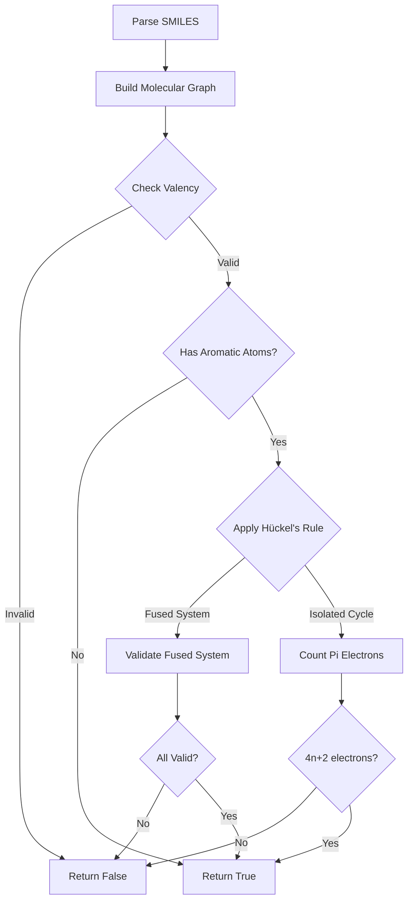

# Chemical Validation Algorithms

This document describes the chemistry validation algorithms used by the SMILES parser to ensure molecular structures are chemically valid.

## Valence policy (decided: permissive, octet-bound for row 2)

The default chemistry backend (`ChemistryValidator(backend="pysmiles")`) is
**deliberately permissive**: it accepts radicals and the expanded-octet /
hypervalent species of period 3 and below — e.g. sulfate, `[SH6]`,
`F[P-](F)(F)(F)(F)F` — and rejects only physically impossible *over*-valence.
This is a considered choice, not an omission:

- OpenSMILES itself does not mandate a valence model; valence checking is a
  policy layered on top of the language.
- Generative-model output (the primary use case) legitimately contains
  radicals and hypervalent species that RDKit's default sanitizer rejects.

What counts as "impossible" (`chem/adapter.py`, `valence_violations`):

| Rule | Example rejected | Example accepted |
|---|---|---|
| Second-row atoms (B, C, N, O, F) cannot expand their octet: only the lowest valence of the isoelectronic element (N 3, N⁺ 4, O 2, O⁻ 1) | `N(C)(C)(C)C`, `[NH4]C`, `[OH3]C`, `C(N)=[NH2]` | `[NH4+]`, `[NH2+]=C(N)N` |
| …except the conventional neutral pentavalent-N shorthands (RDKit charge-separates them) | — | `CN(=O)=O`, `c1ccn(=O)cc1`, `C=N#N`, `N=N#N` |
| A closed-shell ion cannot bond | `[Cl-]C`, `[F-][B+3]…` | `[Na+].[Cl-]` |
| d/f-block metals get no valence limit; a neutral N/O bonded to one is a dative donor | `[NH4][Pt]…` | `[NH3][Pt]([NH3])(Cl)Cl`, `Cl[Pt-2](Cl)(Cl)Cl` |
| Main-group atoms of period 3+ use pysmiles' electron-count maximum | `O[AlH3](O)O` | `O=S(=O)(O)O` |

Until October 2026 neutral 4-valent N (`N(C)(C)(C)C`) and `[OH4]` were
accepted as "hypervalent".  Second-row atoms have no d orbitals to expand
into, and public datasets showed these strings are always a missing charge
or an extra hydrogen, so they are now rejected — with a repair suggestion.

## Repairs, body pH and salts

A chemistry failure comes with a repair when changing one atom fixes it
(`chem/repair.py`): drop hydrogens (`[AlH3]` → `[Al]`), add a charge
(`O=N([O-])C` → `O=[N+]([O-])C`), or move a bonded ion's charge onto its
partner (`[Cl-][Pt]` → `Cl[Pt-]`).  Only the edited atoms are rewritten, so
stereo and atom order are kept; `ValidationResult.repaired_smiles` holds the
result and `repairs` one explanation per atom.

When a nitrogen can be fixed either way (`=[NH2]` → `=[NH2+]` or `=[NH]`),
`physiological_ph=True` (default) picks its protonation state at pH 7.4 from a
small pKa table (`PKA_TABLE`: guanidines and amidines protonated, N-cyano
guanidines neutral, …).  With it off, the written charge is kept.

`remove_salts=True` (default) splits multi-component input into
`parent_smiles` (most heavy atoms) and `removed_fragments`.  Every component
is still validated: a broken counter-ion makes the record invalid and is named
in `failed_fragment`, so salt removal never hides a data error.

## cis/trans marks

`/` and `\` mark cis/trans direction.  OpenSMILES spells them as directional
*single* bonds, so `C=N\#N` is two bonds in a row and a syntax error there.
This validator treats the mark as an annotation instead: written in front of
another bond symbol it is accepted, ignored (a double or triple bond carries
no cis/trans direction of its own) and reported in
`ValidationResult.warnings`.

Callers who want RDKit-equivalent strictness can opt in with
`ChemistryValidator(backend="rdkit")` /
`validate_smiles_detailed(mol, backend="rdkit")`.

Note that `C11` — which the pysmiles backend used to wave through — is now
rejected *before* chemistry, by the ring-semantics tier (OpenSMILES §3.4:
an atom cannot close a ring onto itself). Ring-closure rules are language
semantics, not valence policy.

## Overview

The validation system checks two main aspects of molecular chemistry:

1. **Aromaticity Validation** - Uses Hückel's rule to validate aromatic ring systems
2. **Valency Validation** - Uses the octet rule to validate atom bonding

---

## Hückel's Rule (Aromaticity)

### What is Hückel's Rule?

Hückel's rule is a method to determine if a cyclic, planar molecule is aromatic. A molecule is aromatic if it has **4n+2 π electrons**, where n is a non-negative integer (0, 1, 2, 3, ...).

Common aromatic electron counts:
- n=0: **2 π electrons** (e.g., cyclopropenyl cation)
- n=1: **6 π electrons** (e.g., benzene, pyridine, pyrrole)
- n=2: **10 π electrons** (e.g., naphthalene)
- n=3: **14 π electrons** (e.g., anthracene)

### Implementation

The validation is performed by `MolecularGraph.huckel()`:

```python
n = (pi_electrons - 2) / 4
# Valid if n is a non-negative integer
```

### Pi Electron Counting

Each atom type contributes a specific number of π electrons in `_count_pi_electrons()`:

| Atom Type | π Electrons | Notes |
|-----------|-------------|-------|
| C (aromatic) | 1 | sp² hybridized carbon |
| N (pyridine-like) | 1 | No attached hydrogen |
| N (pyrrole-like) | 2 | Has attached hydrogen `[nH]` |
| O, S | 2 | Lone pair contributes |
| Se, As | 2 | Lone pair contributes |
| B, P | 1 | |

### Fused Ring Systems

For fused aromatic systems (e.g., naphthalene, anthracene), the validator uses relaxed rules:

1. Groups cycles into fused ring systems (sharing 2+ atoms)
2. For complex systems (3+ rings) where all atoms are aromatic, trusts SMILES notation
3. For 2-ring fused systems, validates that at least one cycle satisfies Hückel's rule

See `validate_fused_aromatic_system()`.

---

## Octet Rule (Valency)

### What is the Octet Rule?

The octet rule states that atoms tend to form bonds to achieve 8 electrons in their valence shell (or 2 for hydrogen). This determines how many bonds each atom can form.

Common valencies:
- **Carbon (C)**: 4 bonds
- **Nitrogen (N)**: 3 bonds
- **Oxygen (O)**: 2 bonds
- **Hydrogen (H)**: 1 bond
- **Sulfur (S)**: 2, 4, or 6 bonds

### Implementation

Valency is checked by `MolecularGraph.check_valency_for_aba()`:

```python
total_bonds = hcount + bond_count
if atom.symbol == "C" and total_bonds < 4:
    return False  # Carbon needs 4 bonds
```

### Bracket Atoms

For bracket atoms (e.g., `[CH3]`, `[NH2]`), the validator checks:
1. Explicit hydrogen count (`hcount`)
2. Number of bonds to other atoms
3. Total must satisfy the atom's valency requirement

---

## Validation Flow



---

## Examples

### Valid Molecules

| SMILES | Molecule | Validation |
|--------|----------|------------|
| `c1ccccc1` | Benzene | 6 π electrons (n=1) ✓ |
| `c1ccncc1` | Pyridine | 6 π electrons (n=1) ✓ |
| `c1cc[nH]c1` | Pyrrole | 6 π electrons (N+H contributes 2) ✓ |
| `c1ccc2ccccc2c1` | Naphthalene | Fused system, 10 π electrons ✓ |

### Invalid Molecules

| SMILES | Issue |
|--------|-------|
| `c1cccc1` | 5 atoms but 5 π electrons (not 4n+2) |
| `[CH]` | Carbon with 1 bond (needs 4) |

---

## References

- [Hückel's Rule - Wikipedia](https://en.wikipedia.org/wiki/H%C3%BCckel%27s_rule)
- [Octet Rule - Wikipedia](https://en.wikipedia.org/wiki/Octet_rule)
- [OpenSMILES Specification](http://opensmiles.org/opensmiles.html)
